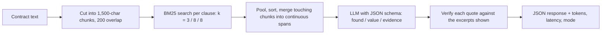

# contract-analyzer

**Live demo:** [contract-analyzer-nebl.onrender.com](https://contract-analyzer-nebl.onrender.com). Click "Try a sample contract" for an instant result, or upload a contract PDF. Free hosting: the first visit after a quiet spell takes about a minute to wake up.

Legal teams read contracts to find the handful of clauses that carry risk. This service finds three of them in a contract PDF (**governing law**, **cap on liability**, **non-compete**), returns each with the exact sentence and page it came from, and checks every quote against the document in code.

On 40 contracts it never saw during development, it found **92% of liability caps at 88% precision** and **95% of governing-law clauses with no false alarms**, reading excerpts picked by keyword search instead of whole contracts: **4.7× fewer tokens** with no accuracy loss on long contracts. Evaluated against lawyer-labeled contracts ([CUAD](https://www.atticusprojectai.org/cuad)), with a held-out test set, per-clause recall and precision, and a measured comparison of retrieval methods.

## Results

**Held-out test set**: 40 contracts drawn at random from contracts never used for tuning; excerpt mode; settings frozen before the run.

| Clause | Recall | Precision | Contracts with the clause |
| --- | --- | --- | --- |
| Governing law | **95%** (35 of 37) | **100%** (35 of 35) | 37 of 40 |
| Cap on liability | **92%** (22 of 24) | **88%** (22 of 25) | 24 of 40 |
| Non-compete | 62% (5 of 8) | 71% (5 of 7) | 8 of 40 |

Evidence quotes verified word for word against the text the model was shown: 66 of 68 (97%). Average 4,313 input tokens and 20.9 s per contract (free tier; latency is mostly queueing). Counts are small: non-compete appears in only 8 of the 40 contracts, so its rates could move a lot with a larger sample.

**Whole contract vs retrieved excerpts** (10 long dev contracts, 100–190 KB each, same prompt and model):

| | Whole contract | Excerpts (BM25) |
| --- | --- | --- |
| Governing law, correct | 10/10 | 10/10 |
| Cap on liability, recall / precision | 100% / 50% | 100% / 56% |
| Non-compete, recall / precision | 100% / 100% | 100% / 100% |
| Avg input tokens | 29,317 | **6,227** (4.7× fewer) |
| Avg latency | 31.4 s | **16.5 s** |

**Retrieval** (343 dev contracts, 852 lawyer-highlighted sentences; recall@k = share of highlighted sentences inside the chunks sent; governing law / cap / non-compete):

| Method | Chunks sent | Governing law | Cap | Non-compete |
| --- | --- | --- | --- | --- |
| **BM25, top 3** (shipped for governing law) | 3 | **98%** | 76% | 44% |
| **BM25, top 8** (shipped for cap, non-compete) | 7.9 | **100%** | **89%** | **68%** |
| BM25, top 12 | 11.6 | 100% | 91% | 74% |
| Embeddings (bge-base), top 3 | 3 | 65% | 49% | 29% |
| Embeddings, top 8 | 7.9 | 84% | 72% | 54% |
| Hybrid, rank fusion, top 8 | 7.9 | 97% | 86% | 70% |
| Hybrid merge, 5 + 5 | 7.8 | 100% | 89% | 67% |
| Hybrid merge, 8 + 8 | 11.9 | 100% | 92% | **80%** |

**PDF text** (341 dev PDFs, parsed with `pypdf`): 840 of 845 lawyer-highlighted sentences recoverable from our extracted text (99.4%), against 845 of 845 from CUAD's reference text. No scans in the set; 0.16 s per PDF.

## What it returns

```json
{
  "governing_law": {
    "found": true,
    "value": "Delaware",
    "evidence": "This Agreement is governed by the laws of the State of Delaware.",
    "evidence_verified": true
  },
  "cap_on_liability": {
    "found": true,
    "value": "Neither party shall be liable for consequential damages",
    "evidence": "Neither party shall be liable for consequential damages.",
    "evidence_verified": true
  },
  "non_compete": { "found": false, "value": null, "evidence": null, "evidence_verified": false },
  "model": "gemini-3.5-flash",
  "mode": "retrieved",
  "chunks_sent": 17,
  "input_tokens": 6189,
  "output_tokens": 412,
  "seconds": 8.9
}
```

- `found: false` is an explicit, allowed answer, so the model is never forced to invent a clause.
- `evidence_verified` is computed in code, not by the model: the quote must appear verbatim (whitespace-normalised) in the text the model was given. A quote from the model's memory fails.
- `POST /extract-pdf` takes an uploaded PDF and adds `page` (where each quote starts) and `pages` to the same response.

## How it works



- `extractor.py`: the core. Prompt, schema, the model call, both reading modes (`whole`, `retrieved`), evidence verification. Everything else imports it, so the service and the evals can never drift apart.
- `retriever.py`: chunking and BM25 search. Also holds the vector-search and hybrid code used in the comparison above.
- `documents.py`: PDF to text, page by page; refuses scanned PDFs (no text layer) instead of sending the model an empty contract; finds the page each quote starts on.
- `api.py`: FastAPI. `POST /extract` (text) and `POST /extract-pdf` (upload, 10 MB cap, `413` / `422` on bad files). `422` on bad input, `503` on model failure, never a `200` with empty fields. `GET /health`.

## How it is evaluated

- **Labels:** CUAD, 510 commercial contracts annotated by trained law students. Each clause has a yes/no or value answer and the highlighted source sentences.
- **Two piles:** contracts are split 70/30 with a fixed seed. Prompts, definitions and retrieval queries were tuned only on the dev pile; the test pile is scored once, with settings frozen.
- **Four outcomes per clause:** found right, missed, false alarm, absent right. Reported as recall (share of real clauses caught) and precision (share of reports that are real), next to a do-nothing baseline. Plain accuracy is not used as the headline because it hides whether errors are misses or false alarms.
- **Retrieval has its own eval** (`eval_retrieval.py`), free and model-free: does the top-k contain the lawyers' sentence? The extractor cannot beat this number on retrieved text. Highlights that contain CUAD's `<omitted>` annotation marker are matched on the text before the marker; an earlier version of the check missed this and understated recall by 1 to 3 points.
- **PDF parsing has its own eval** (`eval_pdf.py`), also model-free: can the lawyers' sentences be found in the extracted text at all?
- **Running and scoring are separate.** Runs save raw model output with the labels; `score.py` re-scores any saved run without calling the model.

## Decisions, with the numbers behind them

- **BM25 over vector search, hybrid as the measured next step.** Embeddings alone lost to keyword search on every clause (two models, two chunk sizes, two query styles). Contracts are formulaic ("governed by the laws of"), and general-purpose embedding models score most legal paragraphs as near-identical. Combining the two only pays at a larger budget and only on the least formulaic clause: at about 12 chunks, a merged hybrid reaches 80% non-compete recall against 74% for BM25 alone; at 8 chunks the two are equal. BM25 alone ships for now, because the hybrid needs PyTorch and a 440 MB embedding model in the container for a 6-point gain on one clause. Equal-weight rank fusion was worse than BM25 alone.
- **Excerpts over whole contracts.** 4.7× fewer tokens and ~2× lower latency with no accuracy loss on long contracts. The prompt tells the model it is reading excerpts, so "not found" means "not in what I was shown".
- **Lean toward recall.** A missed liability cap is costly and invisible; a false alarm costs the reader seconds, because every flag arrives with its source sentence.
- **Verify quotes against the text shown, not the whole contract.** This is what catches answers from the model's memory. It also caught a bug in this project: long sentences split across excerpt boundaries failed verification, fixed by merging touching chunks into continuous spans.

## Known limitations

- **Cap-on-liability precision drops on long contracts.** 88% on the random test mix, but 50–56% on ten long dev contracts chosen to stress it. The definition was widened to fix misses on short contracts (recall 33% → 100%) and now also matches indemnity ceilings and price caps that long contracts are full of. The next fix is to anchor the definition to liability for breach of the agreement, tuned on dev only.
- **Non-compete retrieval recall is 68% at k = 8** (74% at 12, 80% with the hybrid at 12). Some non-competes are written as specific prohibitions ("will not conduct any Work using…") with no competition vocabulary for keyword search to match.
- **PDF text extraction occasionally splits words** in letter-spaced headings ("P ARTY" for "PARTY"), which lost 5 of 845 highlights. Scanned PDFs are refused, not OCR'd.
- **Small samples.** The whole-vs-excerpt comparison uses 10 contracts; the test set 40, with only 8 non-competes. Differences of a few points are within noise.
- **Label noise.** CUAD labels are occasionally inconsistent (for example, one punitive-damages waiver unmarked where similar clauses are marked).
- **Latency on the free tier is dominated by queueing** (5 to 90 seconds per call regardless of size).

## Run it

```bash
python -m venv .venv && source .venv/bin/activate
python -m pip install -r requirements.txt
export GEMINI_API_KEY="..."

# Service
python -m uvicorn api:app --reload            # docs at http://localhost:8000/docs
FAKE_MODEL=1 python -m uvicorn api:app        # canned answers, no API key needed

curl -s -X POST localhost:8000/extract -H 'Content-Type: application/json' \
  -d '{"text": "This Agreement is governed by the laws of the State of Delaware.", "mode": "whole"}'
curl -s -X POST localhost:8000/extract-pdf -F "file=@contract.pdf"
```

Evaluation needs CUAD v1 unzipped into `data/CUAD_v1/` ([Zenodo](https://zenodo.org/record/4595826)):

```bash
python eval_retrieval.py dev bm25                   # retrieval recall, no model calls, seconds
python eval_pdf.py 343                              # PDF text quality, no model calls
python eval_test.py                                 # held-out run; resumable, stops after 18 calls
python score.py results_test_retrieved.jsonl        # recall / precision / baseline per clause
```

The vector-search comparison additionally needs `pip install -r requirements-experiments.txt`.

## Layout

```
extractor.py        core: prompt, schema, model call, reading modes, evidence check
retriever.py        chunking, BM25, (vector and hybrid search for comparison)
api.py              FastAPI service: /extract, /extract-pdf, /health
documents.py        PDF to text with page numbers; scan detection
data.py             CUAD loading and the dev/test split
eval_cuad.py        extraction eval on dev samples (small / large, whole / retrieved)
eval_retrieval.py   retrieval recall@k, model-free
eval_test.py        held-out test run, resumable
score.py            re-scores any saved run: recall, precision, baseline
eval_pdf.py         PDF text quality against the lawyers' highlights
inspect_retrieval.py  debugging: where each search ranks the right chunk
```
